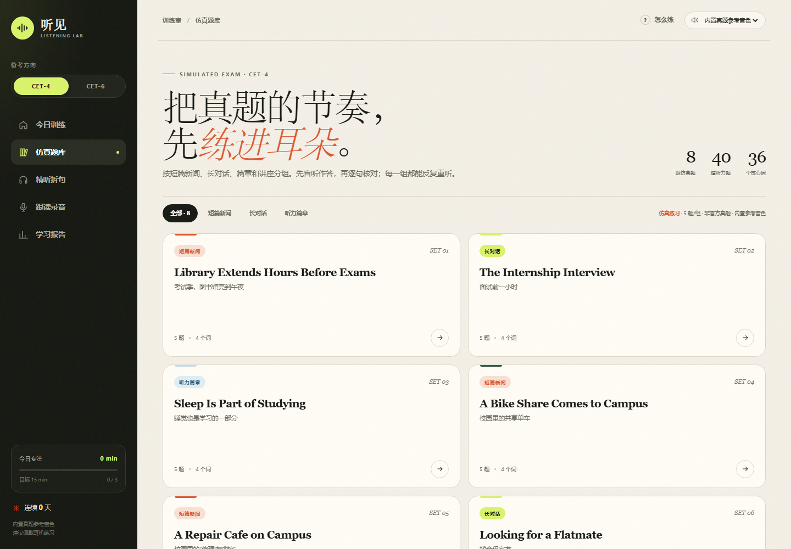

# 听见 · CET 听力室

一个纯静态的 CET-4 / CET-6 英语听力练习页。没有后端、没有构建步骤，直接部署到 GitHub Pages 就能在电脑和手机上使用。



## 里面有什么

- **16 套仿真精练**：CET-4 / CET-6 各 8 套，每套 5 题，共 80 道四选一题，覆盖短篇新闻、长对话、听力篇章和讲座。
- **108 段内置音频**：句子、精听和跟读音频都已随页面打包，手机打开不需要选择本机文件。
- **逐句精听**：0.75× / 1.25× 变速、循环播放、逐句听写，提交后按词对比。
- **跟读录音**：8 句跟读素材，可录音回放；录音只留在当前页面内存里，不上传。
- **学习记录**：答题数、正确率、连续天数、每周练习时长，保存在浏览器 `localStorage`，可导出 JSON。

> 这是 **5 题一组的精练版**，不是真实考试 25 题的完整套题；适合一次练 10–15 分钟，先把题型和节奏练熟。

## 部署到 GitHub Pages

1. 在 GitHub 新建一个仓库，例如 `tingjian-cet-listening`，选择 **Public**。
2. 把 `听力室` 文件夹 **里面的内容** 上传到仓库根目录，不要再多套一层 `听力室/` 文件夹。
   - 根目录应该能看到 `index.html`、`assets/`、`README.md`。
3. 打开仓库的 **Settings → Pages**。
4. **Build and deployment → Source** 选择 **Deploy from a branch**。
5. **Branch** 选择 `main`，目录选择 `/ (root)`，点 **Save**。
6. 等 1–2 分钟，访问：

   ```text
   https://<你的GitHub用户名>.github.io/tingjian-cet-listening/
   ```

仓库里已经包含 `.nojekyll`，不需要额外的构建配置。

### 用 GitHub Desktop / 命令行

```bash
git init -b main
git add .
git commit -m "Initial commit: 听见 · CET 听力室"
git remote add origin https://github.com/<你的用户名>/tingjian-cet-listening.git
git push -u origin main
```

推送后按上面的 Settings → Pages 步骤开启 Pages。

## 本地预览

在 `听力室` 文件夹里打开终端：

```bash
python -m http.server 8765
```

然后访问 `http://127.0.0.1:8765/`。

直接双击 `index.html` 也能播放和做题；但浏览器对本地文件的麦克风限制更严，跟读录音建议用本地服务器或 GitHub Pages 打开。

## 文件结构

```text
听力室/
├─ index.html            页面外壳
├─ assets/
│  ├─ styles.css         视觉与响应式布局
│  ├─ data.js            题库、精听语料、跟读素材、音频键
│  ├─ audio-map.js       108 段音频的 base64 数据
│  └─ app.js             播放器、答题、精听、录音、进度
├─ preview.png           README 预览图
├─ README.md
├─ LICENSE               代码许可（不含音频）
├─ NOTICE.md             音频与版权说明
├─ .nojekyll             让 GitHub Pages 不做 Jekyll 处理
└─ .gitignore
```

## 音频与版权

页面里的 108 段英语音频是预先合成好的。音色参考了项目提供者的一段 **2025 年 6 月 CET-4 听力录音** 中的单人开场片段，用参考音色逐句合成。

- 这不是官方 CET 发行音频，题目、选项和译文也都是仿真练习，不是官方真题。
- 这段参考录音和合成音频可能涉及版权/声音权利。**公开部署前请确认你有公开传播的授权。**
- 如果没有公开授权，建议先移除 `assets/audio-map.js`，或者替换成你自己拥有权利的录音；页面会自动回退到浏览器语音合成。
- 代码使用 MIT 许可；**音频不在 MIT 许可范围内**，详见 [NOTICE.md](NOTICE.md)。

如果只是自己练习，放在本地或私有仓库里使用即可。

## 技术说明

- 纯 HTML + CSS + 原生 JavaScript，无框架、无 CDN、无后端。
- 音频以 base64 data URI 存储在 `assets/audio-map.js`，通过 `new Audio(...)` 播放。
- 题库数据在 `assets/data.js`，每段音频通过 `audioKey` 与 `audio-map.js` 对应。
- 学习记录使用 `localStorage`，键名为 `tingjian-cet-listening-v1`。
- 响应式布局：桌面侧边栏，移动端顶部栏 + 底部标签栏。

## License

代码部分使用 MIT License。音频、音色参考和任何第三方考试材料不包含在 MIT 许可中，请阅读 [NOTICE.md](NOTICE.md)。